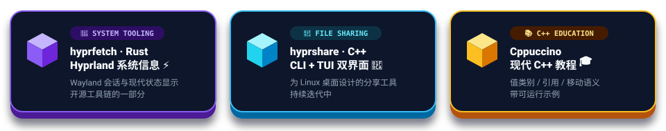
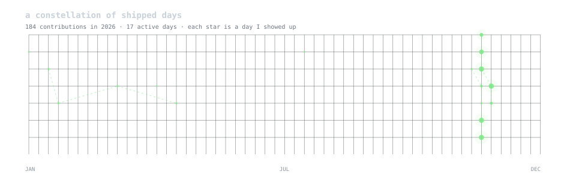
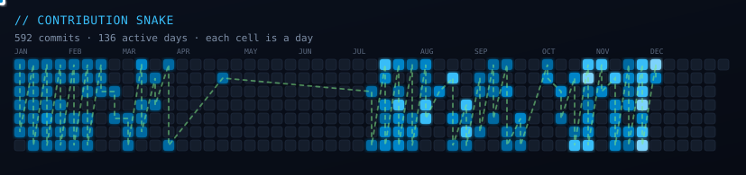
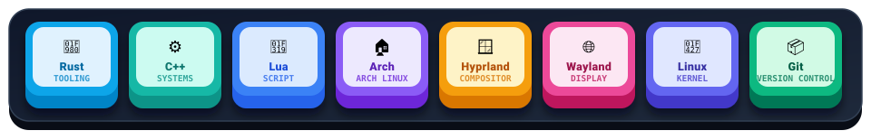

# Howie (polarours)

📫 [polarours@zohomail.com](mailto:polarours@zohomail.com)

Linux tinkerer and Arch + Hyprland daily driver. I build small tools for the Hyprland ecosystem and write about modern C++.

Most of my side projects are utilities for the Hyprland ecosystem: [hyprfetch](https://github.com/polarours/hyprfetch) and [hyprbridge](https://github.com/polarours/hyprbridge) in Rust, [hyprshare](https://github.com/polarours/hyprshare) in C++, plus [hyprstream](https://github.com/polarours/hyprstream), [hyprbeat](https://github.com/polarours/hyprbeat) and my [dotfiles](https://github.com/polarours/dotfiles). [Cppuccino](https://github.com/polarours/Cppuccino) is a compact C++ tutorial and reference repo with hands-on examples; [LuaPath](https://github.com/polarours/LuaPath) is my Lua study log.

## A year of shipped days

Each star is a day I showed up; the brightest ones are connected into a constellation.

A neon snake patrols the same grid — one cell per day, brighter cells for heavier days.

## Stack

---

© 2026 Howie · [polarours@zohomail.com](mailto:polarours@zohomail.com)
