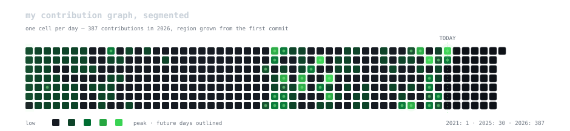

# Howie (polarours)

Linux tinkerer, segmentation researcher and Arch + Hyprland daily driver. I am currently developing tools for the Hyprland environment and writing about modern C++. Everything I maintain lives in [my repositories](https://github.com/polarours).

Most of my side projects are utilities for the Hyprland ecosystem: [hyprfetch](https://github.com/polarours/hyprfetch) and [hyprbridge](https://github.com/polarours/hyprbridge) in Rust, [hyprshare](https://github.com/polarours/hyprshare) in C++, plus [hyprstream](https://github.com/polarours/hyprstream), [hyprbeat](https://github.com/polarours/hyprbeat) and my [dotfiles](https://github.com/polarours/dotfiles). [Cppuccino](https://github.com/polarours/Cppuccino) is a compact C++ tutorial and reference repo with hands-on examples; [LuaPath](https://github.com/polarours/LuaPath) is my Lua study log.

My research is in semantic segmentation: LCTS-Net for construction-area extraction and FOCS-Net for oil-spill detection. I run the experiments on a 5090, keep a per-project dev log, and treat every number in a paper as something that must be reproducible.

## Segmenting my contribution graph

Every cell is a day, shaded by commit count; the glow marks the high-confidence days. Outlined cells are the unwritten rest of the year. This redraws daily from public contribution data via GitHub Actions, so it always reflects what I have actually been working on.

[github](https://github.com/polarours) · [polarours@zohomail.com](mailto:polarours@zohomail.com)
